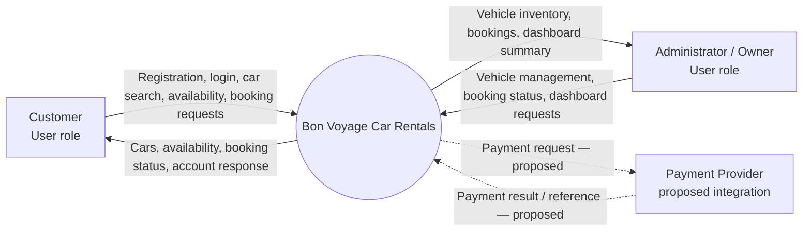
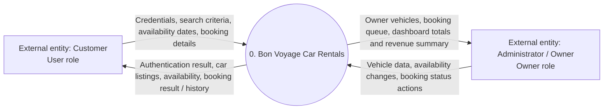
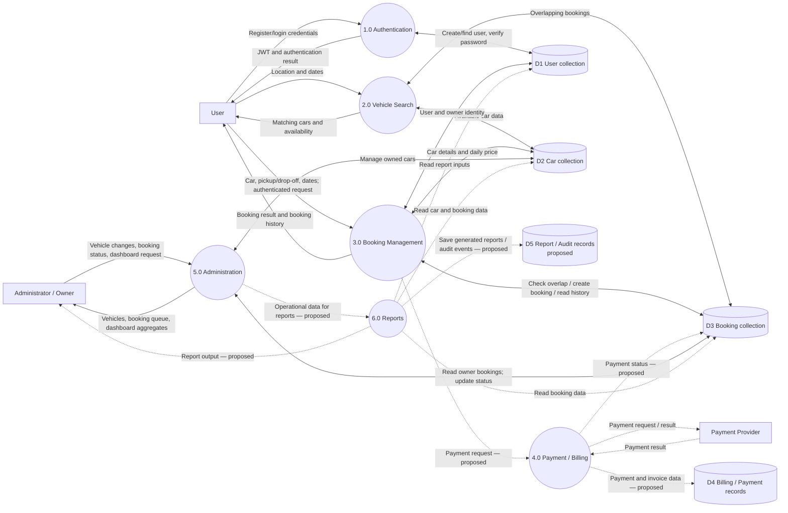
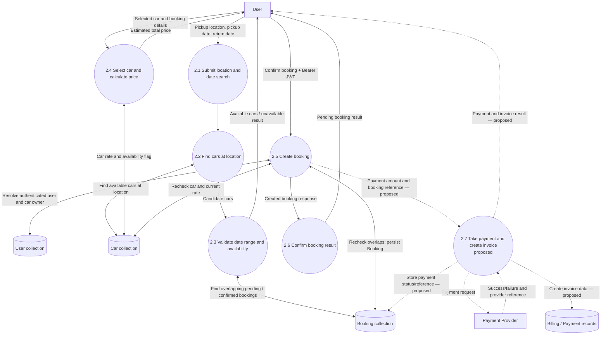
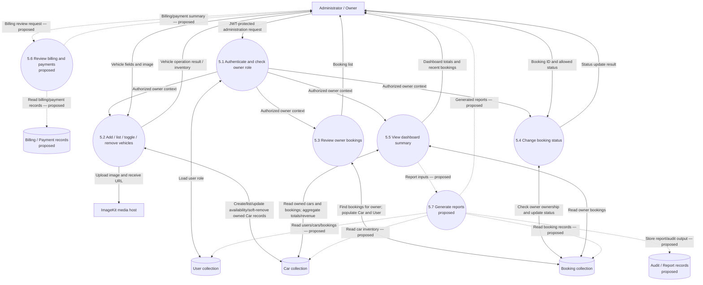
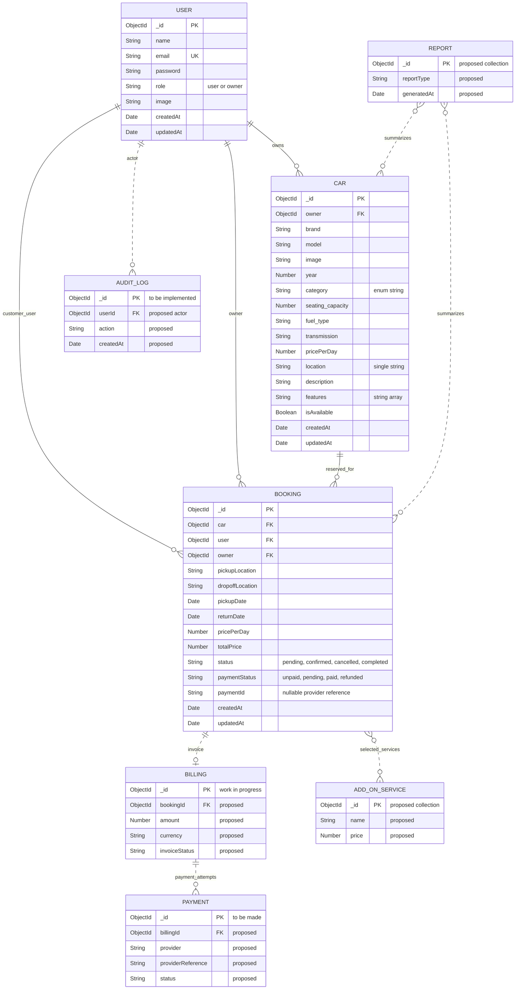

# Bon Voyage Car Rentals — Context, Data Flow, and ER Diagrams

These diagrams use the current source models and routes in `server/models`, `server/controllers`, and `server/routes`, plus the project handoff in `chat.md`. Current MongoDB collections are `User`, `Car`, and `Booking`. A customer is a `User` with `role: "user"`; an administrator is a `User` with `role: "owner"`. There is no separate Customer collection.

**Notation:** solid flows/entities exist in the current application; dashed elements and flows are proposed additions for requested future capabilities. Payment provider integration, billing/invoices, report generation, add-on services, and audit logs are not implemented in the current code. `Car.category` is an enum string, and `Car.location`, `Booking.pickupLocation`, and `Booking.dropoffLocation` are strings; there are no separate Category or Location collections.

## 1. System Context Diagram

## 2. DFD Level 0

The application is shown as one process with its external actors and main exchanges.

## 3. DFD Level 1

Data stores map to the implemented MongoDB models. Payment/Billing and Reports are proposed processes, not current endpoints or collections.

## 4. DFD Level 2 — Customer Booking

The implemented availability endpoint checks the location, dates, `isAvailable`, and overlapping pending/confirmed bookings. Booking creation rechecks availability, calculates price using `pricePerDay × rental days`, then stores a pending and unpaid Booking. Invoice/payment actions are proposed.

## 5. DFD Level 2 — Administrator

Owner-only routes currently add, list, toggle availability, and soft-remove cars; retrieve owner bookings and dashboard aggregates; and change booking status. Billing review and report generation are shown as proposed additions because no billing/report model or endpoint exists in the project code.

## 6. Entity Relationship Diagram

Solid entities and relationships correspond to existing Mongoose models and references. Dashed entities/relationships are explicitly proposed to cover the requested future ERD scope; they must not be read as existing collections.

### ERD modeling notes

- Customer and Administrator are **User roles**, not separate entities: `User.role` is `user` or `owner`.
- `Car.category` is currently a string constrained by a Mongoose enum. A separate Car Category entity/table is not implemented or needed to represent the current schema.
- Location is stored as plain strings on Car and Booking. The diagram does not create a Location entity or FK.
- Billing, Payment, Report, Audit Log, and Add-On Service are shown with dashed relationships and `proposed` field labels because no corresponding models, collections, or workflows are present in the current source.
- The current `Booking.paymentStatus` and `paymentId` are fields only; they do not constitute a payment processor, Billing model, or invoice workflow.
