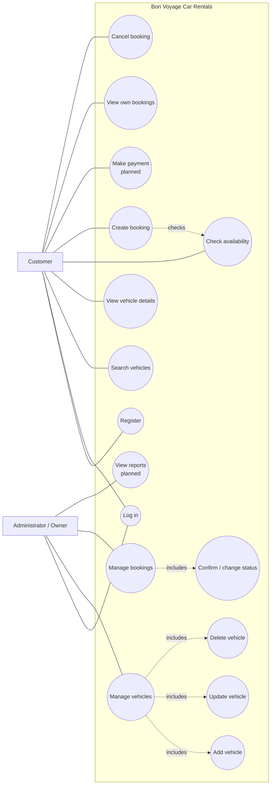
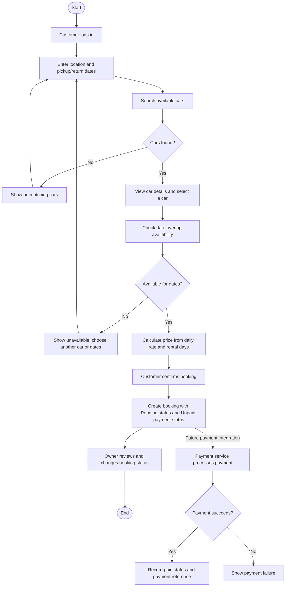
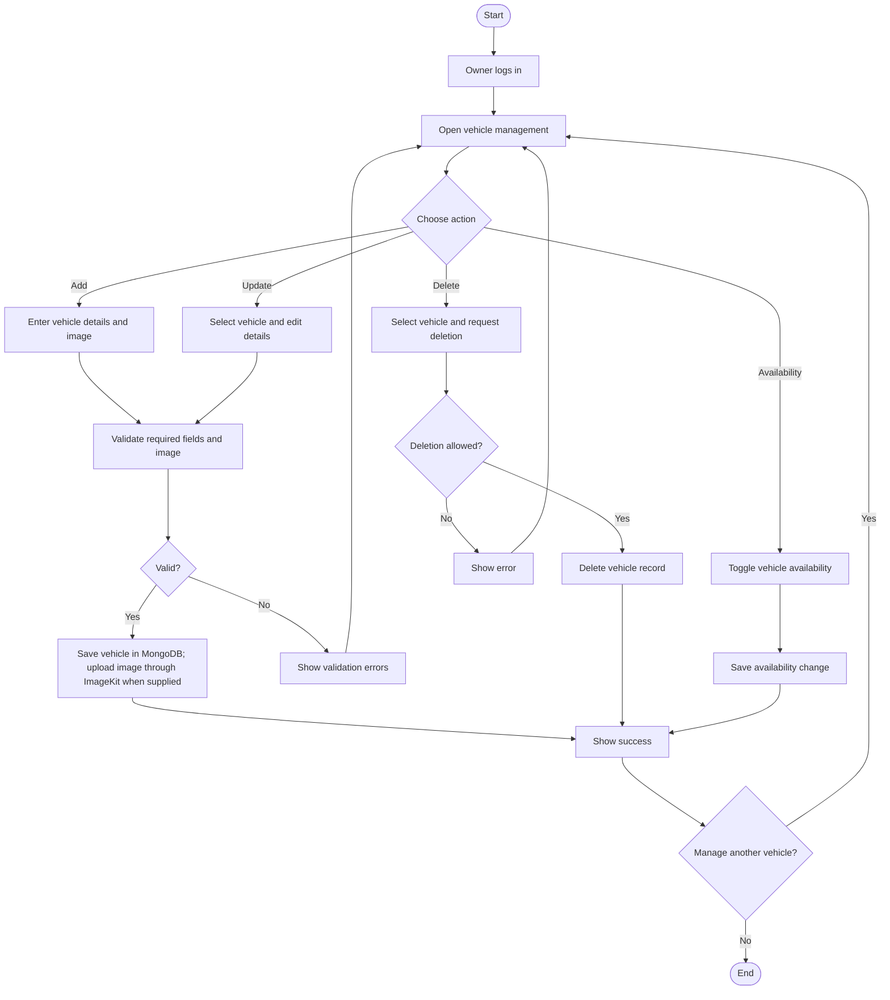
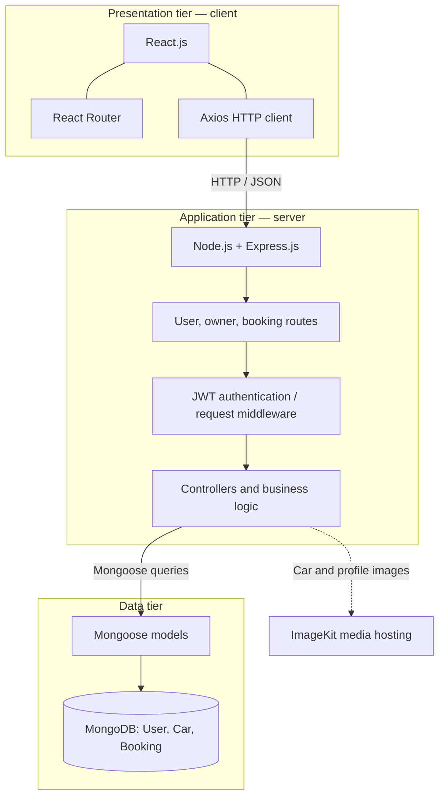
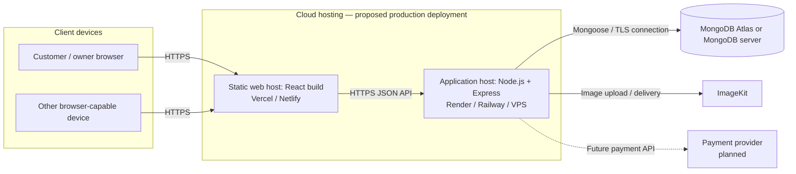
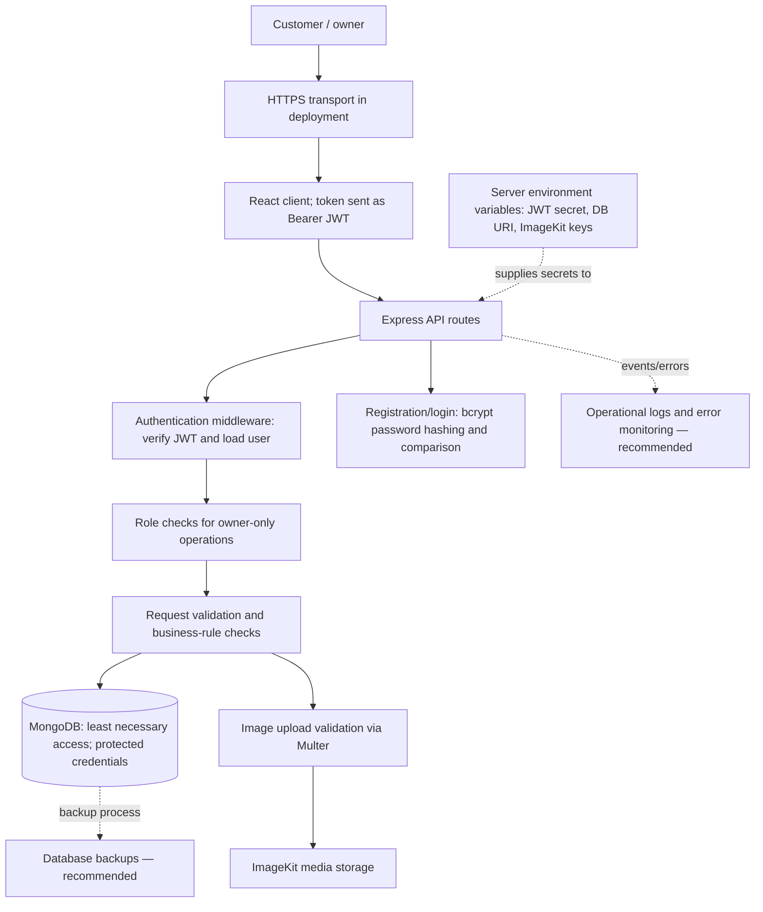
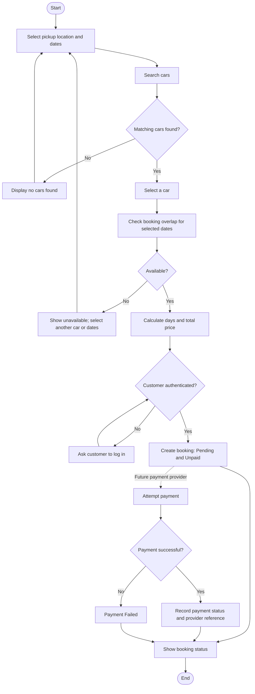

# Bon Voyage Car Rentals — System Diagrams

These diagrams describe the current MERN application and distinguish implemented behavior from proposed features. The application currently stores users with a `role` (`user` or `owner`), cars, and bookings. Payment processing, billing, and reporting are planned concepts; no payment provider or separate Billing/Report model is currently implemented. “Administrator” below refers to the existing owner role.

## 1. Use Case Diagram



## 2. Activity Diagram — Booking



Current application behavior ends at creation of a pending, unpaid booking and owner status management. The payment branch is planned only.

## 3. Activity Diagram — Vehicle Management



## 4. State Diagram — Booking

```mermaid
stateDiagram-v2
  [*] --> Draft
  Draft --> Pending: customer submits booking
  Pending --> Confirmed: owner confirms
  Pending --> Cancelled: customer/owner cancels
  Pending --> PaymentFailed: planned payment attempt fails
  PaymentFailed --> Pending: retry payment / resume
  Confirmed --> ActiveRental: rental pickup
  Confirmed --> Cancelled: cancellation
  ActiveRental --> Completed: rental returned
  Completed --> [*]
  Cancelled --> [*]
  note right of Draft: Conceptual state; current API creates Pending directly.
  note right of PaymentFailed: Planned; payment integration is not implemented.
  note right of ActiveRental: Conceptual lifecycle state; current schema does not include it.
```



## 5. UML Class Diagram

```mermaid
classDiagram
  class User {
    +ObjectId _id
    +String name
    +String email
    +String password
    +String role = user|owner
    +String image
    +Date createdAt
    +Date updatedAt
  }
  class Customer {
    <<logical role view; same User model>>
  }
  class Car {
    +ObjectId _id
    +ObjectId owner
    +String brand
    +String model
    +String image
    +Number year
    +String category
    +Number seating_capacity
    +String fuel_type
    +String transmission
    +Number pricePerDay
    +String location
    +String description
    +String[] features
    +Boolean isAvailable
    +Date createdAt
    +Date updatedAt
  }
  class Booking {
    +ObjectId _id
    +ObjectId car
    +ObjectId user
    +ObjectId owner
    +String pickupLocation
    +String dropoffLocation
    +Date pickupDate
    +Date returnDate
    +Number pricePerDay
    +Number totalPrice
    +String status
    +String paymentStatus
    +String paymentId
    +Date createdAt
    +Date updatedAt
  }
  class Billing {
    <<documented business entity>>
    +Number amount
    +String currency
    +String invoiceStatus
  }
  class Payment {
    <<documented business entity>>
    +String provider
    +String providerReference
    +String status
  }
  class Location {
    <<single-string value>>
    +String value
  }
  class Report {
    <<documented business entity>>
    +String reportType
    +Date generatedAt
  }
  User <|-- Customer : role view; same model
  User "1" --> "0..*" Car : owns
  Customer "1" --> "0..*" Booking : creates
  Car "1" --> "0..*" Booking : booked in
  User "1" <-- "0..*" Booking : owner
  Car ..> Location : location is one string
  Booking "1" --> "0..1" Billing : billed as
  Billing "1" --> "0..*" Payment : payment attempts
  Report ..> Booking : summarizes
  Report ..> Car : summarizes
```

The current MERN models are `User`, `Car`, and `Booking`; `Customer` is shown as the user role view (the same `User` model, with `role: "user"`) rather than a separate collection. As specified for this documentation, Billing, Payment, and Report are treated as complete business entities, and Location is represented by one string value. `Car.location` remains a string field in the current schema; Location is a logical value, not a separate referenced MongoDB document.

## 6. Sequence Diagram — Booking

```mermaid
sequenceDiagram
  actor Customer
  participant UI as ReactJS Interface
  participant API as Express API
  database DB as MongoDB
  participant Pay as Payment Service (planned)
  Customer->>UI: Choose location, dates, and car
  UI->>API: POST /api/bookings/check-availability
  API->>DB: Find overlapping pending/confirmed bookings
  DB-->>API: Matching bookings / none
  API-->>UI: Availability result
  UI-->>Customer: Show availability and price estimate
  Customer->>UI: Confirm booking
  UI->>API: POST /api/bookings/create (Bearer JWT)
  API->>DB: Load car and recheck availability
  DB-->>API: Car and availability data
  API->>API: Validate dates; calculate total price
  API->>DB: Save Pending, Unpaid booking
  DB-->>API: Created booking
  API-->>UI: Booking result
  UI-->>Customer: Show booking confirmation / pending status
  opt Future payment integration
    API->>Pay: Create payment request
    Pay-->>API: Payment result and reference
    API->>DB: Update paymentStatus / paymentId
    API-->>UI: Payment result
  end
```

## 7. Sequence Diagram — Login

```mermaid
sequenceDiagram
  actor User
  participant UI as React Login Form
  participant API as Express userController
  participant DB as MongoDB
  participant Auth as protect middleware
  User->>UI: Enter email and password
  UI->>API: POST /api/user/login
  API->>DB: Find user by normalized email
  DB-->>API: User record with password hash
  API->>API: bcrypt compares password
  alt Credentials valid
    API->>API: Sign JWT (userId, 7-day expiry)
    API-->>UI: User data and token
    UI->>UI: Store token; set Bearer Authorization header
    UI->>API: GET /api/user/data
    API->>Auth: Verify Bearer JWT
    Auth->>DB: Load user by token userId
    DB-->>Auth: User without password
    Auth-->>API: Attach authenticated user
    API-->>UI: User data
    UI-->>User: Show role-appropriate application/dashboard
  else Invalid credentials
    API-->>UI: Generic invalid email or password response
    UI-->>User: Show login error
  end
```

## 8. Three-Tier Architecture



## 9. Deployment Diagram



Cloud providers and production deployment are illustrative targets from the project README, not a claim that the system is currently deployed there.

## 10. Security Architecture



HTTPS, secret management, robust validation, monitoring, and automated backups are deployment/security requirements or recommendations; the diagram does not imply every control is fully configured in the current application.

## 11. Booking Flowchart



Current behavior creates a `pending` booking with `unpaid` payment status after date and availability validation. Payment steps are future integration flow.
